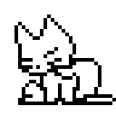

  <h1>Hi, I'm Felix 👋 aka eierman</h1>

  
Working in IT &nbsp;·&nbsp; E-scooter tuner &nbsp;·&nbsp; Breaking game mechanics for fun

  
  
  
  
  
  

 

---

### 🚀 About me

- 💻 **Working in IT:** breaking and fixing things is literally my job.
- 🛴 **E-scooter tuning:** modding them and making them faster than intended. Only SHU so far, VESC is coming up.
- 🎮 **Gamer:** I enjoy finding exploits and breaking game mechanics.
- 🛠️ **Side projects:** small tools that scratch my own itch, from Fortnite chest counters to Minecraft plugins and userscripts.
- 🌐 **Not a native speaker:** English isn't my first language, but I try my best. German is.
- 💬 **Feel free to reach out**, I don't bite 🙂

---

### 📦 Projects

| | Project | What it does |
|---|---|---|
| 🎯 | **[StormReport](https://github.com/eierman324/StormReport)** | Counts the chests you open in Fortnite, match after match, with an in-game overlay |
| 🎬 | **[anidl-renamer](https://github.com/eierman324/anidl-renamer)** | Userscript for the AniWorld Downloader web UI that renames episodes to their real titles |
| 🎵 | **[fakecrime-music-import](https://github.com/eierman324/fakecrime-music-import)** | Userscript that adds SoundCloud / YouTube songs to your fakecrime.bio music player |
| 📖 | **[horimiya-manga-order](https://github.com/eierman324/horimiya-manga-order)** | Recuts Horimiya + The Missing Pieces into manga order, one file per volume |
| 🛴 | **[G2MApp](https://github.com/eierman324/G2MApp)** | Web app for the KuKirin G2 Master electric scooter |
| 💥 | **[FabisOSC](https://github.com/eierman324/FabisOSC)** | Orbital Strike Cannon as a Paper plugin and Fabric mod |
| 🚪 | **[DomainGate](https://github.com/eierman324/DomainGate)** | Minecraft plugin: block, redirect or set a custom MOTD per connecting domain |
| 🎙️ | **[RecordPlayer](https://github.com/eierman324/RecordPlayer)** | Windows tray app that plays an audio input live |

---

### 🎌 Anime

I'm mostly into **romance, drama and slice of life**: give me a show that makes me cry and I'm happy.
So far: **79 anime, 900 episodes**, and a planning list that keeps growing faster than I can watch.

  
  
  
  
  
  

Some of my 10/10s · full list on <a href="https://anilist.co/user/eierman324/animelist">AniList</a>

---

### 🎮 Gaming

- 🌪️ **Fortnite:** my main game right now. Built [StormReport](https://github.com/eierman324/StormReport) because I wanted to know how many chests I actually open.
- ⛏️ **Minecraft:** running and playing on SMPs with friends, which is where most of my plugins and mods come from.
- 🔫 **Valorant:** my shooter of choice these days. Used to play Counter-Strike on [FACEIT](https://www.faceit.com/de/players/eierman324).
- 🧩 **Roblox:** poking at how games work under the hood, on my [second channel](https://www.youtube.com/@justloldog).

---

### 🛠️ Tech Stack

  
  
  
  
  
  
  
  
  
  

---

### 📊 GitHub Stats

  
  

  

Cats from <a href="https://github.com/adryd325/oneko.js">oneko.js</a> (MIT)

